# Temporal Writing Workspace — Calm Precision

The [3 November UI v1 closeout](closeout-20261103/README.md) extends this historical redesign evidence with demonstrated reliability fixes, actual before/after captures and current validation limits. Final clean-main package acceptance remains separate.

GitPad+ UI modernization, 2–3 November 2026. Dedicated branch `ui/calm-precision-20261102`; [PR #2](https://github.com/styayur/gitpad-plus/pull/2), based on `release/alpha1-closeout-20261031` (`969c8af`). The stacked base keeps Win2D licensing, packaging and release infrastructure outside this review.

## Design and implementation

The calendar is an index of days, while the selected note is a quiet writing page. Circular date selection, note-count markers, the selected-day heading, date-bearing tabs and the date above the title form a consistent date track. Plain note rows replace repeated cards; grouped commands and a note action menu leave the page title and text as the writing focal point.

The [design system](../../../.interface-design/system.md) records semantic tokens, typography, spacing, surfaces, states, native material ownership and responsive behavior. Windows uses Mica Alt where supported, Acrylic only for the native calendar flyout, and system-color opaque fallback in high contrast. The WebView paints readable opaque content. Android retains platform system bars and uses actual IME resize insets.

Native calendar navigation, multiple notes and panes, Milkdown, plugin-owned commands, local/Git status and existing storage/bridge interfaces remain in place. There is no invented notebook or multi-vault feature. `Git: NotConfigured` remains accurate.

## Actual rendered comparison

These are application captures, not mockups. Desktop Web captures use the real .NET DevHost and a disposable synthetic vault, 1440×960 at 1×. Before is `969c8af`; after includes the distinct formatting glyphs and final settings copy. A Markdown H1 matching the note title is intentionally retained in both views: the redesign does not rewrite source content to remove it.

| Before | After |
|---|---|
| 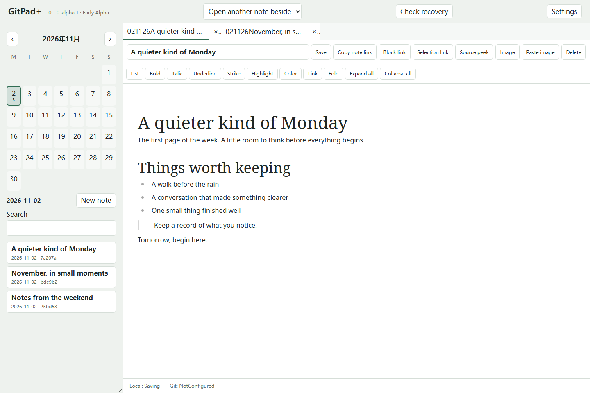 | 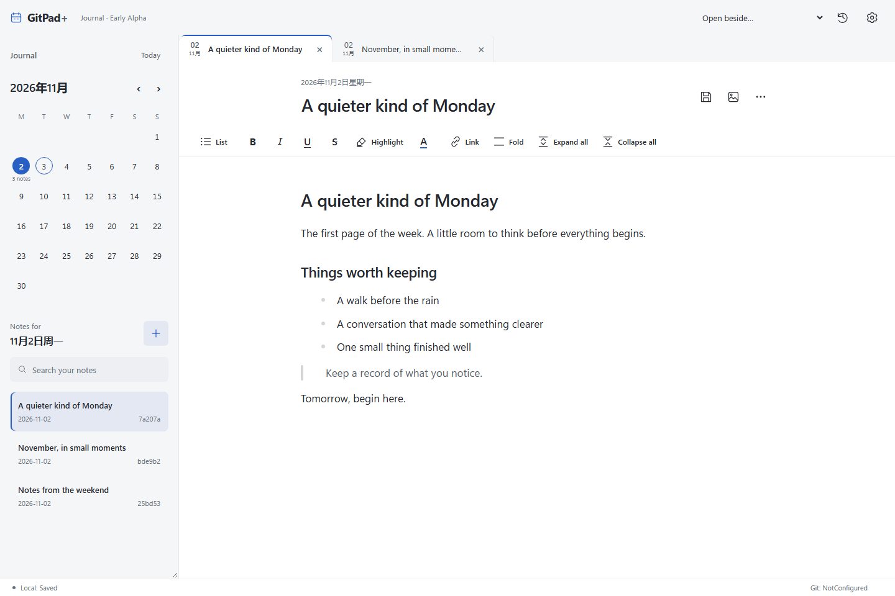 |
| 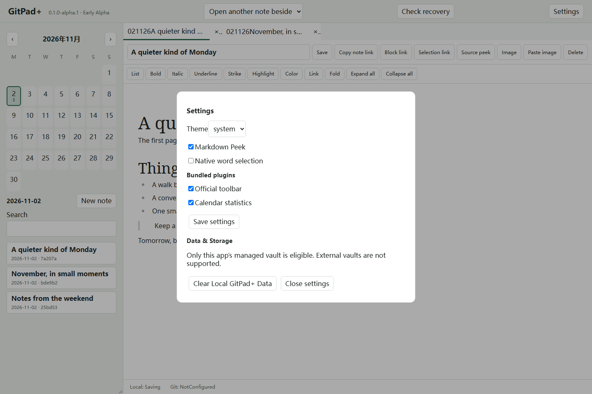 | 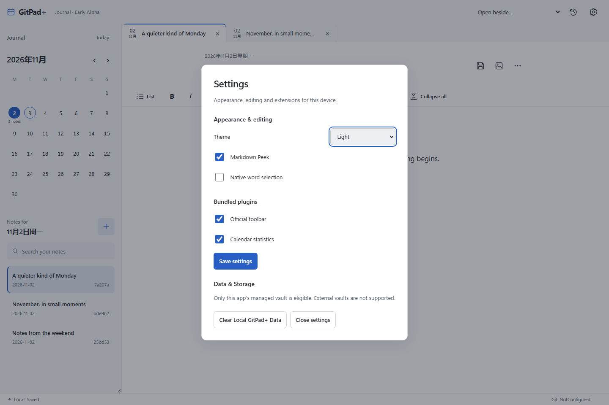 |
| 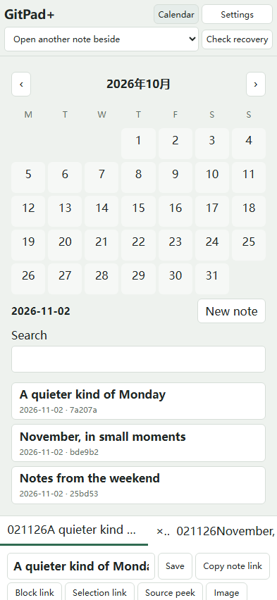 | 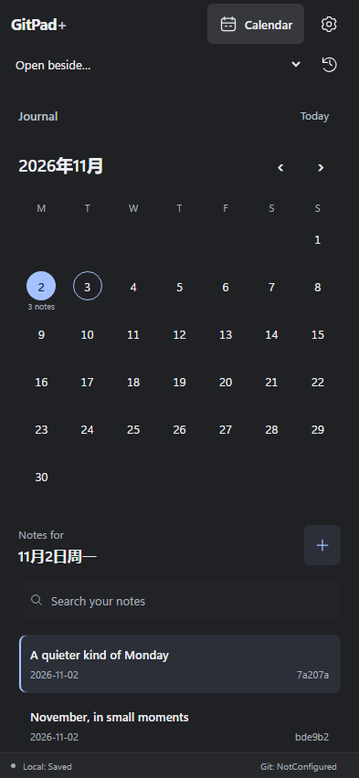 |

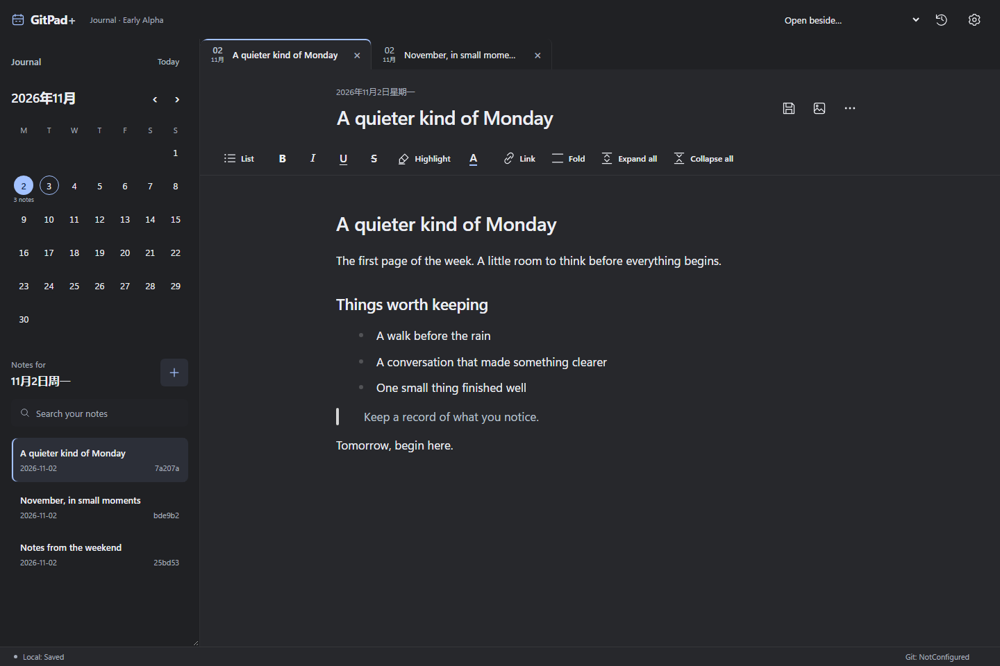

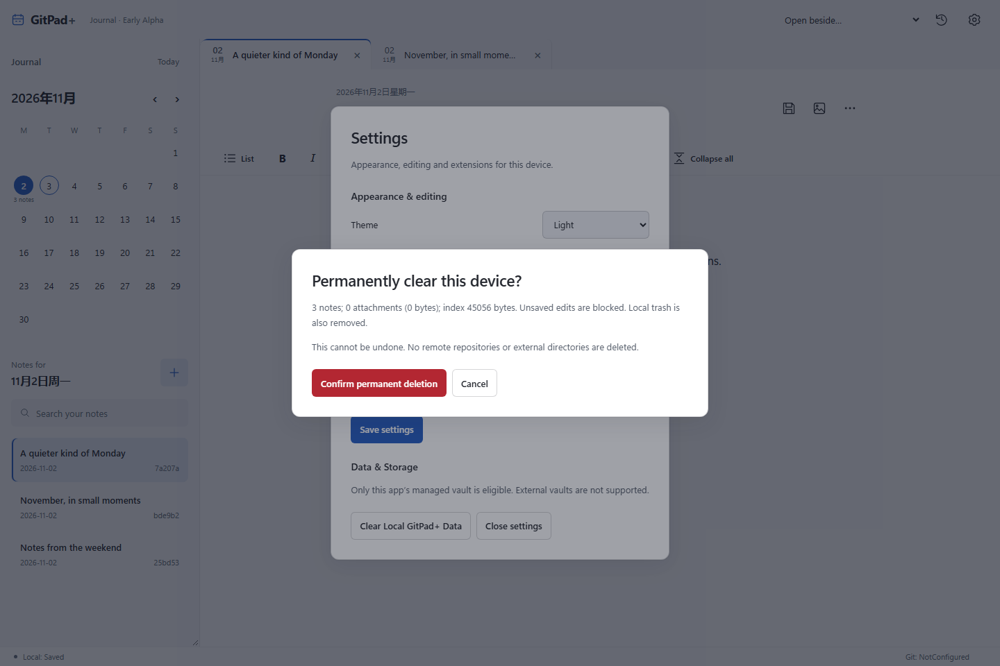

The native Windows high-contrast captures below were taken after applying the OS Aquatic contrast theme, with the app explicitly set to light. They demonstrate the real system-color override and native calendar fallback, separately from browser forced-colors emulation. The contrast theme was then restored to None.

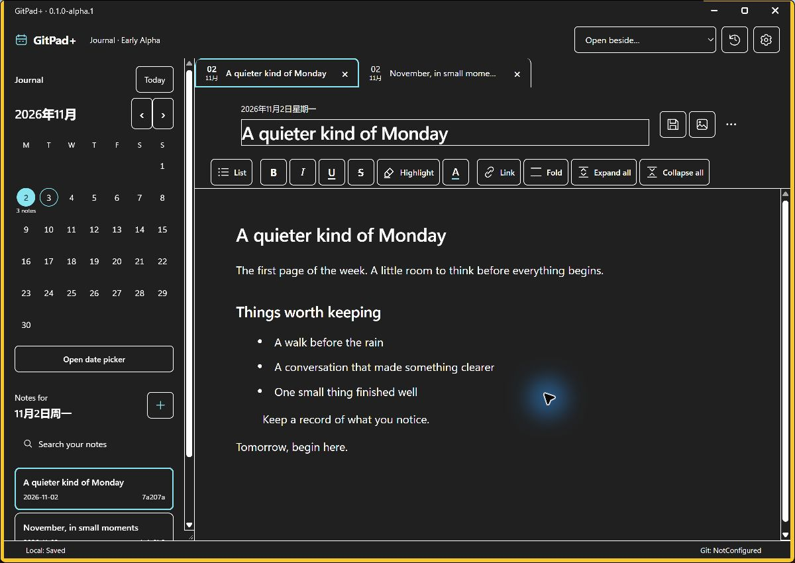
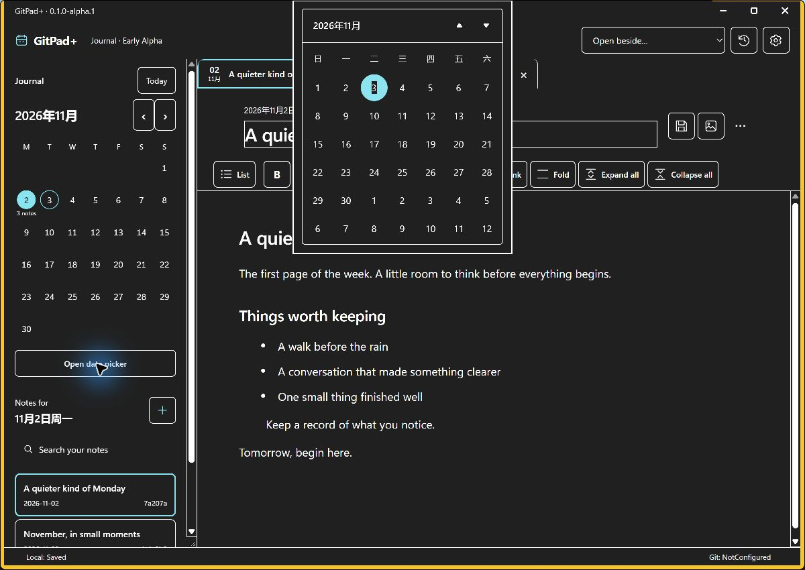

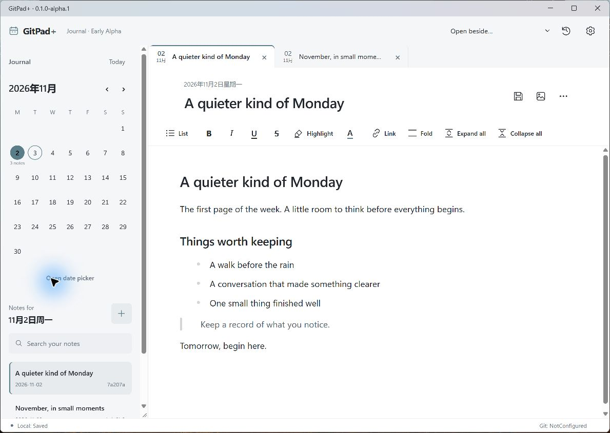
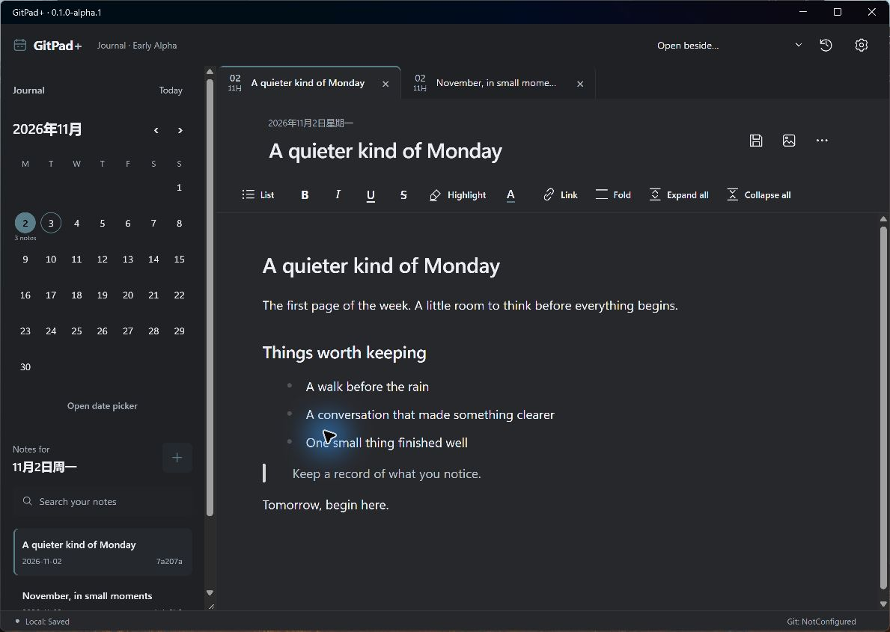

The Android baseline is a historical actual `969c8af` native capture from the earlier acceptance run, not a recreation using today's fixture. It shows the former duplicated native status/header and ungrouped settings. The new native screenshots are captured separately on this branch.

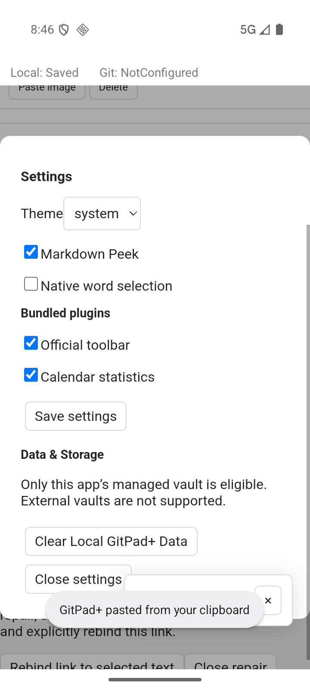

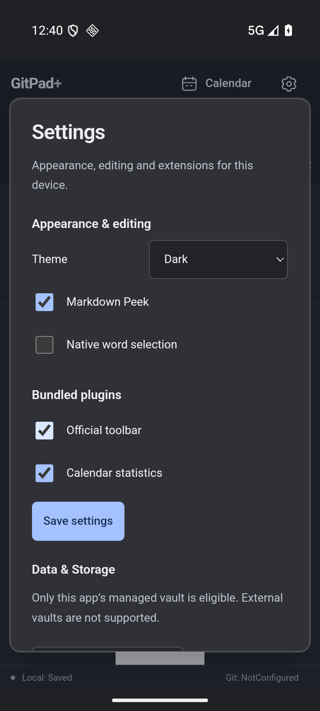
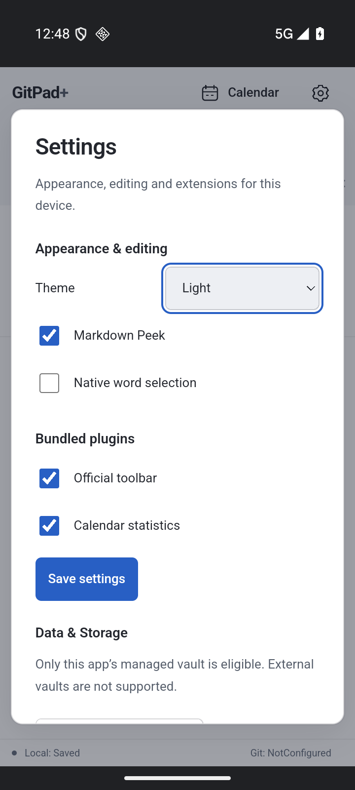
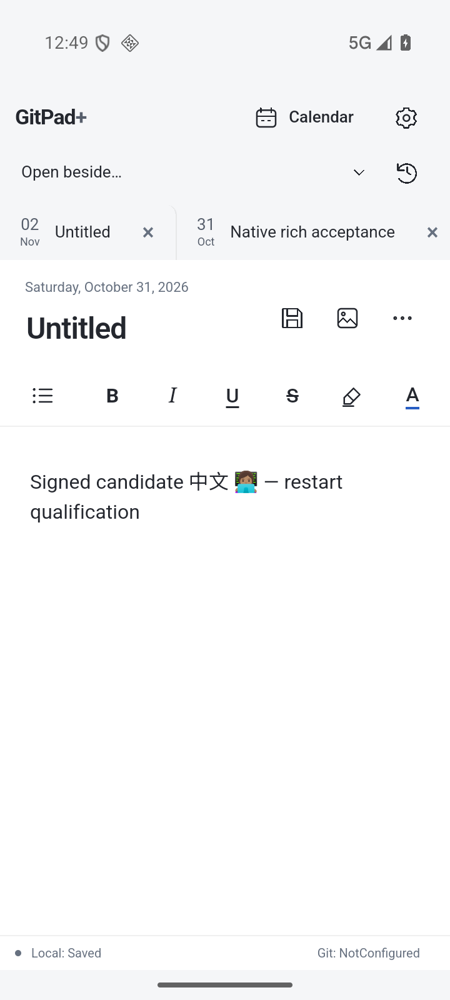
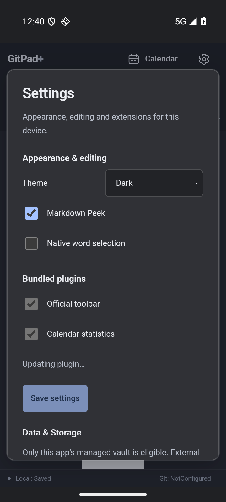
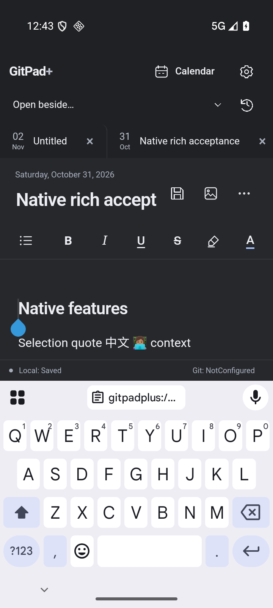

## Interface-design review

Method: `Dammyjay93/interface-design`, pinned at `2f9be3206855bcb2d1d0af262c8bae25cba6658d`; SKILL.md, design-review and design-deslop command instructions. This is an agent review using independent visual lenses, not a claim of independent human or subagent approval. It reviews against GitPad+'s own Calm Precision intent.

| Lens | Rendered finding and decision |
|---|---|
| Hierarchy | Before, every date and command was an outlined box. After, the month leads browsing; page title/body lead writing. Metadata, save actions and header controls recede through weight, color and space. |
| Typography and color | Segoe/platform sans is intentional for mixed Chinese/Latin writing and Windows legibility. 28/23/19 headings, 17/1.8 document text and 13/12 chrome produce visible tiers. Graphite surfaces retain one meaningful date accent, with native accent ink chosen by luminance. |
| Surfaces and depth | Opaque page/canvas steps organize content; no blur over text, decorative gradients or repeated card shadows. Dialogs alone lift. High contrast replaces the material treatment with system colors. |
| Composition | A 288px date index serves an 840px page column. Dense tabs/commands give way to a spacious text measure. On narrow screens, explicit Calendar navigation avoids compressing two peers into one small viewport. |
| States and polish | Real focus rings, modal focus cycling/return, Escape, disabled plugin operations and a textual pending state are implemented. Native DPI, inset and title-theme failures found during review are documented and fixed rather than masked by screenshots. |
| Structure and content | Real HTML buttons/select/details/dialog are reused. `Icon`, `CommandLabel`, `NoteActions` and `Modal` own repeated patterns. Commands keep accessible names and plugin ownership. Status text is real; no artificial sync indicators. |

Design-deslop, scoped to this branch:

| Category | Before | After |
|---|---|---|
| Composition | Repeated rectangular date/note cards | Unboxed month grid, circular selection and plain note rows |
| Action density | Every note action competes beside the title | Save/Image direct; links, source, paste and delete grouped |
| Document type | Default Crepe serif and oversized headings | Shared intentional sans typography and bounded text measure |
| Surfaces | Green wash plus repeated outlines | Neutral journal/page/transient tokens and restrained dividers |
| Symbols | Same fold mark for three commands; ambiguous H | Distinct fold/expand/collapse glyphs and a marker symbol |
| Content | Promotional settings introduction, raw enum labels | Device-scoped explanation and readable theme option labels |
| Feedback | Fast plugin toggles accept another change mid-write | Serialized operation, disabled controls and live pending text |
| Shell | Duplicate native Calendar/status chrome | One Web navigation and status system, with native picker retained |

The swap/squint/signature/token checks support the direction: time-specific navigation survives across five locations, the page dominates writing, colors communicate selection, and token vocabulary identifies journal/page/date roles. Native HTML selects and the compact desktop date target sizes are deliberate project decisions, not dashboard-template defects. Remaining platform validation limits are stated in the acceptance record.

Review verdict: the rendered Web workspace meets the Calm Precision design direction. Native runtime acceptance is a separate gate, tracked below; this verdict does not substitute for those checks.

## Validation record

See [acceptance.md](acceptance.md) and [source-pair-comparison.json](source-pair-comparison.json). Screenshots contain synthetic acceptance notes only. Raw local build/test artifacts remain under `artifacts/ui-02-11-2026`; profiles, vaults, signing material and large build outputs are not committed.

Earlier actual Windows DPI review captures: [100%](screenshots/after-windows-100-dpi.jpg), [125%](screenshots/after-windows-125-dpi.jpg), [150%](screenshots/after-windows-150-dpi.jpg). These precede the final caption foreground correction; final Windows captures above show that correction at restored 200%. [Screenshot hashes](screenshot-hashes.json) identify every committed capture.
