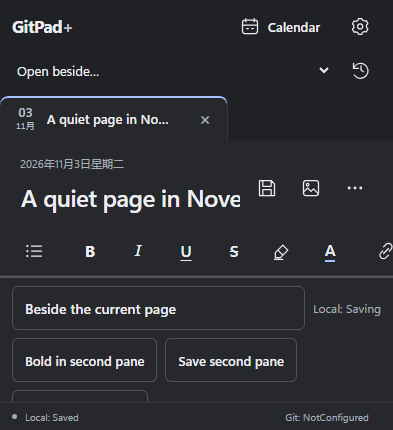
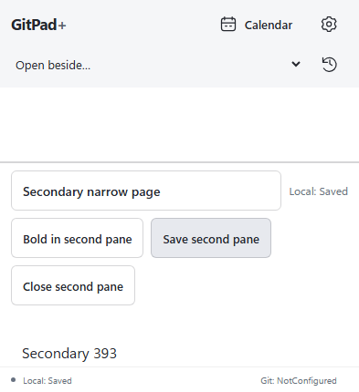
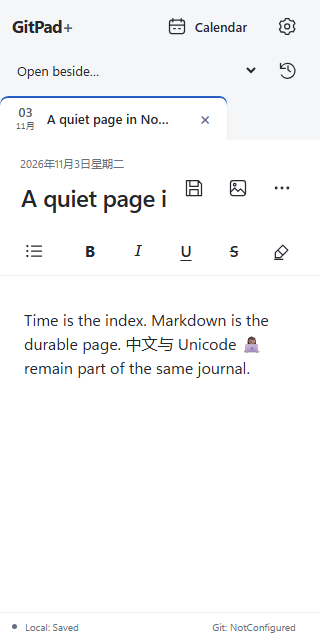
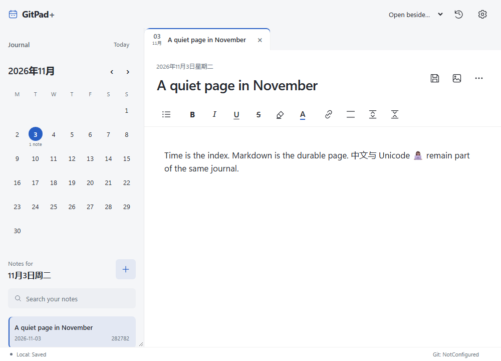
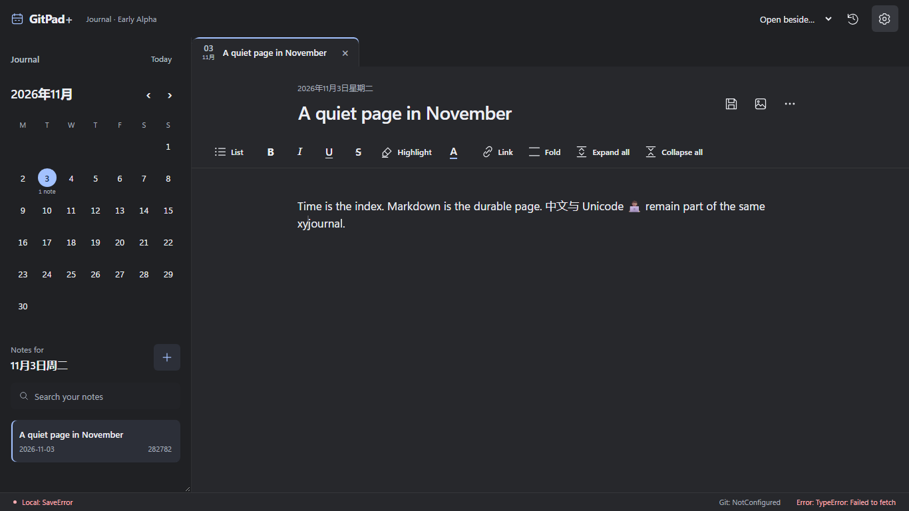
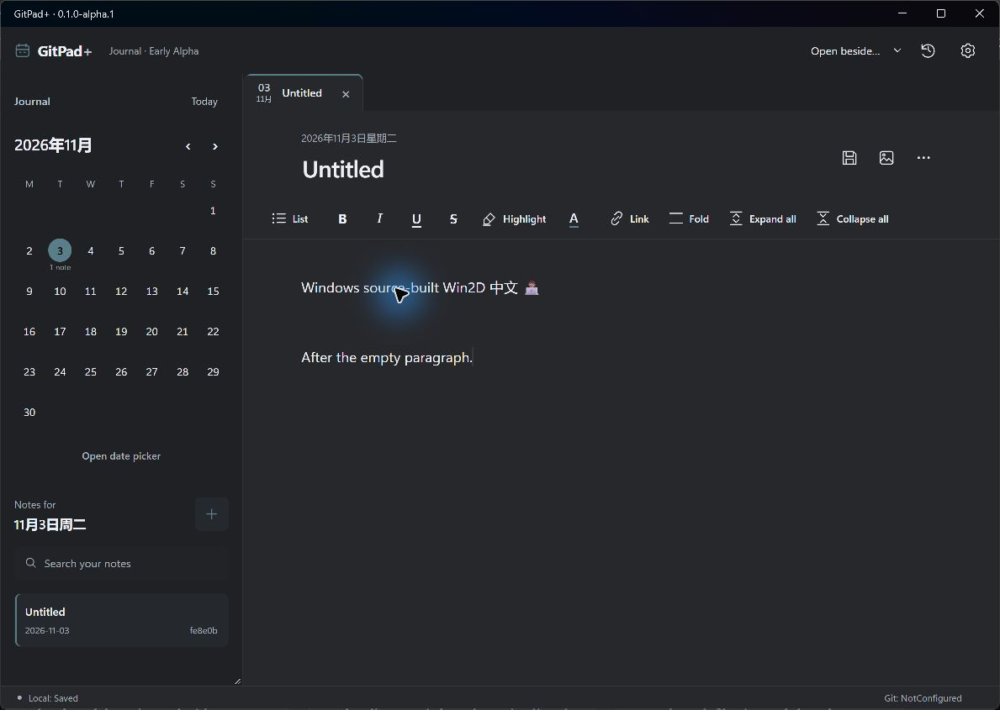
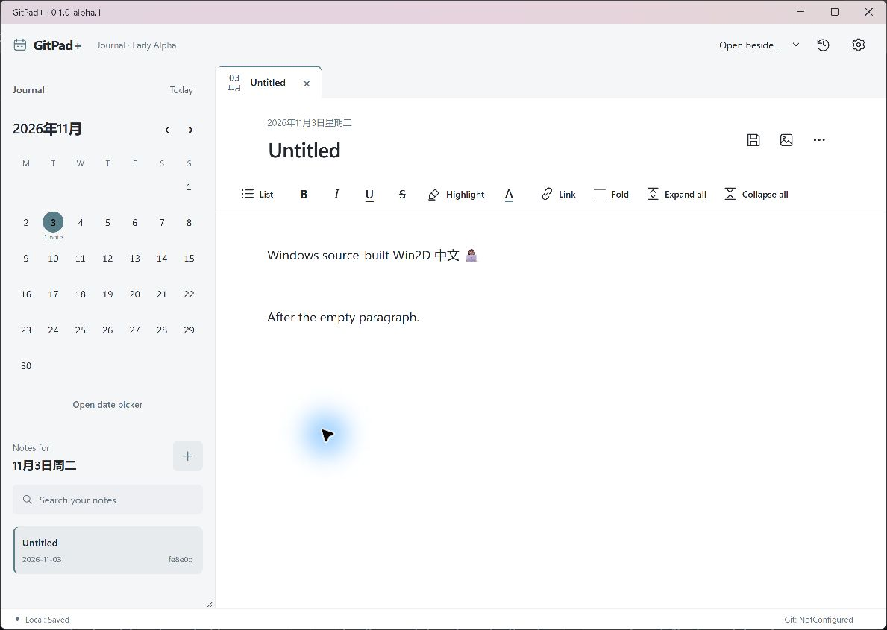

# Calm Precision v1 closeout, 3 November 2026

Scope: the frozen design at main `a171c0e463ebe8fb1009f321da5d3dd2d1a5d48b`, plus the dedicated closeout branch's reviewed changes. These working-tree captures and development native builds are **not final clean-main release acceptance**. The final readiness report must bind fresh packages and acceptance to the merged source SHA.

## Findings and focused corrections

| Severity | Reproduction and cost | Correction / evidence |
|---|---|---|
| P1 | In a new note, type a paragraph, press Enter twice, continue writing, save and reload. Milkdown's canonical ` ` empty-paragraph marker was rejected by the application's top-level HTML precheck, leaving its own writing read-only. | Recognize only the canonical standalone marker, retain exact source bytes and map its paragraph source range. Arbitrary HTML remains protected. The before-fix keyboard regression failed on the missing editor; the after-fix regression preserves body and block UUIDs across reload. The actual Windows application repeated this input/restart path with identical Markdown and sidecar hashes. |
| P2 | With two pages, 320×640 left the second writing viewport about 3px high; at 393×430 both bodies collapsed to 0px. | On narrow/short screens reserve body heights and scroll the two-page workspace, with shell status outside it. Real browser keyboard navigation, editing, independent durable saves and reachable footer pass at both dimensions. An additional Android test-only phase exercises the actual IME; it is not yet counted as executed. |
| P2 | Hold a completed native plugin deactivation response, change Theme while it is pending, then release the response: the earlier settings snapshot restores `system` over the selected `dark`. | Disable all editable preferences while native plugin preference writes are pending, then re-enable them. The before-fix repro and delayed real-backend regression are retained. No settings/storage protocol changes. |
| P3 | MAUI controls use the approved blue, while the app icon/splash still used the old green. | Retain the artwork and replace only that stale token with `#285FC4`. The large empty-day date remains an intentional date-accent exception in the design system. |

The generated license collection also retained an old prebuilt Win2D nuspec under a reused numeric SPDX directory, despite the new inventory listing the source rebuild. The portable collector now archives its prior generated notice tree before collecting the current graph. The fresh collection contains the current artifact; historical candidate/evidence directories are untouched.

## Actual captures

Before and after below show the short two-pane case. The after frame is scrolled to the second page and uses light theme; it demonstrates reachability, rather than a pixel comparison of the themes. Captures are real Chromium/DevHost output against a disposable vault.

| Before: both body heights 0px | After: bodies 160px / 154px, scrollable |
|---|---|
|  |  |

The Windows captures below use the **actual extracted development ZIP**, source stamp `development`, observed window DPI **192 / 200%**. Its ZIP SHA-256 is `38a835f5520baacf9cc60d459f0971ad020b97d61fe7b221cc9964c6614afeb1`; Canvas DLL SHA-256 is `e1de5f0d081a7fadc57bfe594b104869d954f315a2e24214ebf5d89995b047ef`. The app creates and restores a synthetic Unicode note with an intentional empty paragraph. Saving light theme updates the native caption and Web content; Markdown and sidecar hashes remain unchanged through restart and theme change. The blue pointer highlight belongs to the capture/input tooling. These are integration checks, not four-DPI/high-contrast/final-package acceptance.

[Screenshot hashes and scope](screenshots.json) and [browser geometry](browser-metrics.json) accompany the captures. Full raw attempts, logs, traces and source-pair comparisons are retained in `artifacts/final-closeout-20261103/`.

## Design review and deslop

Reviewed the rendered output against `.interface-design/system.md`, using the pinned `interface-design design-review` independent lenses and `design-deslop` rendered/diff passes. The writing title and prose lead; compact date tabs and muted metadata carry context; calendar browsing remains the other primary mode. Segoe/system typography, graphite surfaces, restrained date accent and quiet separation remain coherent. Native HTML dialog/select/button semantics, focus restoration and pending/disabled states remain in use. The blank date display is an intentional time-focused exception, not decorative accent spread.

The concrete layout blocker was the collapsed two-pane body, corrected above. No replacement template, card grid, new font, decorative gradient, animation system or extra blur was introduced. The green-to-blue asset correction removes a demonstrated competing token. The review approves this focused browser/native-integration closeout against the frozen direction; final native multi-DPI, OS contrast and Android keyboard qualification remain separate.

## Targeted code review

Reviewed App resources/window construction, MainPage bridge ownership, Windows appearance/disposal, native file-drop handlers, Android activity/insets, React settings/dialogs, source mapping and acceptance instrumentation. Existing native event unsubscription and disposed guards, main-thread dispatch, physical AppWindow work-area bounds, application-level AdjustResize and Page/Grid safe areas remain intact. The native outer Grid retains file-drop ownership and WebView2 drop remains disabled. No new native lifecycle/coordinate defect was demonstrated in this diff.

No storage schema, UUIDv7 generation, anchor reconciliation algorithm, Markdown marker normalization, recovery semantics, plugin interface or permanent signing identity changed. Empty-paragraph source-range recognition restores the editor's existing marker; it is not a data migration or an HTML-rendering permission.

## Automated results and limits

- 43 Core tests passed; Core implementation is unchanged.
- 52 Vitest tests passed, including canonical-marker fidelity, inline/blockquote source-range boundaries and rejection of other top-level HTML.
- 23 gate/source-package/transport unit tests passed, including package tampering, rewritten provenance, restored-cache corruption, encrypted context binding and uploader-output redaction.
- Before the final inline-range review, a complete default Playwright run passed **41/41** in 5.2 minutes; the two additional tests cover intentional blank paragraphs and stacked short-screen writing. Latest-head CI remains required.
- TypeScript, ESLint, production editor and SDK builds passed. Browser captures include 320, 393, 761, 800, 960, 1000, 1366 and 1920 widths, theme/focus/reduced-motion, forced colors, saving/saved and injected SaveError. Browser forced colors/render scale do not establish native Windows contrast or browser zoom.
- The initial complete browser run was **37 passed / 2 context-teardown timeouts**. A later 13-case fixture run was **12 passed / 1 context-teardown timeout**. Traces place the timeout in context close after the relevant assertions; these remain failed runs. Two initial failing cases passed with tracing off, then all six repeated default-trace runs passed. No timeout threshold or trace configuration was changed to obtain the final 41/41 result.
- The subsequent inline-range review subset returned **11 passed / 2 timeouts**. In the blank-paragraph trace, paragraph count, exact body and block UUID assertions completed before cleanup; the table case reported context-teardown timeout. Those runs remain failures. The source-range guard itself passed the 52-test unit run; CI must verify the final head independently.
- Win2D native x86/x64/ARM64 Release binaries and the AnyCPU projection were built from clean pinned source. Only x64 is packaged. Actual x64 native factories/devices and managed WARP drawing/pixel readback pass; [source-build evidence](../../../../third-party/win2d/README.md) binds exact artifacts.

Remaining release work: latest-head CI/review and merge; clean exact-main Windows ZIP and full AOT universal signed APK; fresh native keyboard/drop/lifecycle/recovery/safe-clear/scale/contrast acceptance; final security/license inventory and all 17 release gates; remote candidate verification; readiness report and the two separate publication approvals. No tag or release has been created by this closeout.
